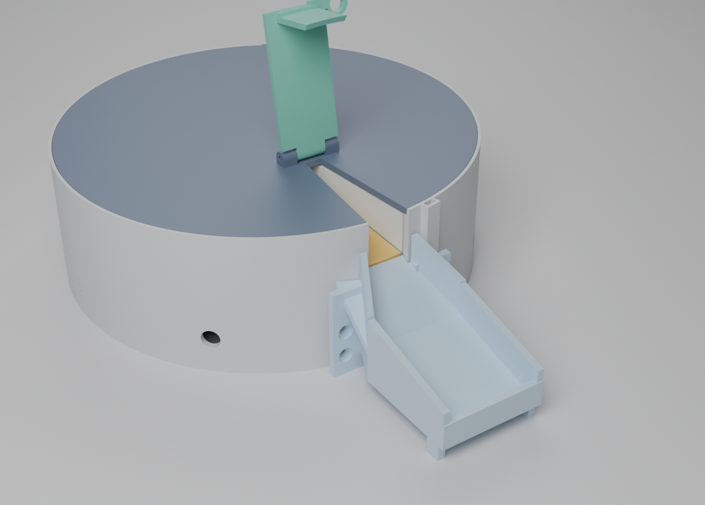

# Scatoletta Blistra

Un portapillole motorizzato open source per chi fa fatica ad aprire blister e scomparti: anziani, persone con artrite o con poca forza nelle mani. All'ora della dose la scatoletta suona, l'utente apre lo sportello e le pillole di quella dose scendono da sole in una vaschetta.

**Modello 3D interattivo:** https://tigrisxvi.github.io/scatoletta-blistra/ (in inglese e in italiano)

**App Blistra:** https://tigrisxvi.github.io/blistra/ (si prova senza account con la modalità demo)

**Stato: prototipo v0.3, progettato e verificato solo al computer. Non è ancora stato stampato né provato su una scheda vera.**

> ⚠️ Non è un dispositivo medico certificato. Non usarlo come unico promemoria per farmaci importanti. Chi lo costruisce lo fa sotto la propria responsabilità.

## Come funziona

- **29 scomparti** su un carosello: 4 dosi al giorno (mattina, pranzo, pomeriggio, sera) per 7 giorni, più uno scomparto di riposo sempre vuoto.
- **Fondo a rampa fisso**: il pavimento sale a elica e sotto l'uscita ha un ripiano piano inclinato verso l'esterno. I setti del carosello flottano in verticale nel mozzo e seguono la rampa, così le pillole non si incastrano.
- **Ripiano pesato e vibrante**: sotto l'uscita c'è una piastra su cella di carico (HX711) con un micro motore vibrante. La vibrazione fa scendere anche le compresse che con l'attrito resterebbero ferme; il peso conferma che la dose è uscita.
- **Sportello con otturatore**: aprendo lo sportello si scopre l'apertura nella parete; un sensore Hall impedisce al carosello di girare con lo sportello aperto.
- **Scivolo e vaschetta**: le pillole scendono in una vaschetta da 40 mm con bordino.
- **ESP32** con motore passo-passo 28BYJ-48, buzzer, LED e pulsante. Si collega opzionalmente all'app web Blistra.

Misure: Ø 166 × 56 mm (62 con la cerniera), 225 mm di profondità con lo scivolo.

## Cosa c'è nel progetto

| Cartella | Contenuto |
|---|---|
| `cad/` | Modello 3D parametrico in Python (manifold3d + trimesh), controlli di interferenza, render Blender, schede tecniche |
| `stl/stampa/` | Pezzi pronti per la stampa 3D |
| `stl/assieme/` | Pezzi nella posizione di montaggio |
| `firmware/` | Programma ESP32 (Arduino IDE) e istruzioni di taratura |
| `simulazioni/` | Simulazione fisica in Blender delle pillole che scendono, con i risultati |
| `docs/` | Schede tecniche in PDF (misure, sensori, schema), immagini e il visore 3D (`docs/modello-3d/`, three.js con licenza MIT) |

## Simulazioni

Simulazione a corpi rigidi (Blender/Bullet) con attrito realistico 0,35, vibrazione 50 Hz e 0,6 mm per 3 secondi, compresse dalle minicompresse da 2 mm fino a una compressa grande come un Augmentin:

- 238 dosi arrivate in vaschetta su 240 (le 2 mancate nel caso peggiore, attrito 0,5);
- 80 su 80 con la geometria esatta della v0.3.

Una simulazione non sostituisce la prova vera: servono test con un prototipo stampato.

## Costruirla

1. Stampa i pezzi di `stl/stampa/` (PLA o PETG).
2. Componenti: ESP32 DevKit, motore 28BYJ-48 con driver ULN2003, cella di carico da 100 g con HX711, motorino vibrante 8×2 mm con MOSFET, 2 sensori Hall A3144 con magneti, buzzer, LED, pulsante. L'elenco completo e lo schema sono nelle schede tecniche.
3. Firmware: segui `firmware/LEGGIMI.txt`. Copia `config.example.h` in `config.h` e scrivi lì le tue password: `config.h` non va mai pubblicato.

## Contribuire

Prove di stampa, foto, misure, correzioni e idee sono benvenute: apri una issue o una pull request.

## Licenze

- Hardware (modelli 3D, STL, schede tecniche): [CERN-OHL-S-2.0](LICENSES/CERN-OHL-S-2.0.txt)
- Software (firmware, script CAD e di simulazione): [MIT](LICENSES/MIT.txt)
- Documentazione e immagini: [CC BY-SA 4.0](LICENSES/CC-BY-SA-4.0.txt)

© 2026 Giuseppe Vasco
