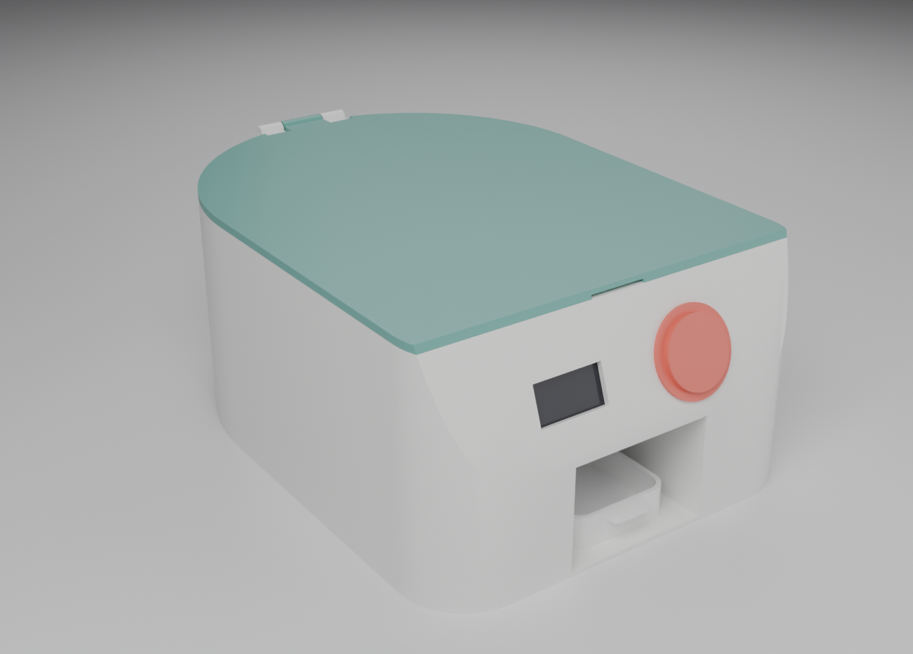

# Scatoletta Blistra

Un portapillole motorizzato open source per chi fa fatica ad aprire blister e scomparti: anziani, persone con artrite o con poca forza nelle mani. All'ora della dose la scatoletta suona e lo scrive sul display; l'utente preme il tasto grande e le pillole di quella dose cadono in un bicchierino che si sfila e si prende in mano.

**Modello 3D interattivo:** https://tigrisxvi.github.io/scatoletta-blistra/ (in inglese e in italiano)

**App Blistra:** https://tigrisxvi.github.io/blistra/ (si prova senza account con la modalità demo)

**Stato: prototipo v0.5, progettato e verificato solo al computer. Non è ancora stato stampato né provato su una scheda vera.**

> ⚠️ Non è un dispositivo medico certificato. Non usarlo come unico promemoria per farmaci importanti. Chi lo costruisce lo fa sotto la propria responsabilità.

## In prova: v0.8, due ruote e due motorini (la più compatta)

Le ruote sono mosse da un ingranaggio sul bordo, con il motorino N20 nell'angolo dove la ruota tonda lascia spazio. Le dosi cadono su un **piattino pesato** (cella di carico da 100 g) che un micro servo apre solo se il peso è quello impostato nell'app; sotto c'è il bicchierino, in una nicchia aperta come in una macchina del caffè, con un magnete nella base e un sensore di Hall nel piede. Corpo scuro e cappello colorato a righine con gli spigoli tondi; tasto tondo da 21 mm sul cappello. Davanti, dietro una griglia, un altoparlante da 20 mm con amplificatore MAX98357A: suona la sveglia e può dire «È ora delle pillole». Ruote con corona dentata vera (modulo 1) e pignoni da 20 denti. I fili di sopra corrono sotto il tetto e scendono in un canale nella parete centrale; corrente da una presa USB-C dietro; l'antenna Wi-Fi dell'ESP32-S3 è a 15 mm dal metallo più vicino. Il visore simula le pillole con la fisica vera (Rapier).

**Stampa 3D:** tutti i pezzi in PETG con ugello da 0,4 mm; pareti da 1,2 mm (3 passate), giochi da 0,3–0,4 mm per le parti che si muovono, denti a modulo 1. `cad/controlli_v8.py` sceglie per ogni pezzo il verso di stampa con meno sbalzi (le STL in `v8/2m/stl/stampa/` sono già girate così): servono supporti soprattutto sotto il tetto della nicchia del corpo. Il piede si stampa capovolto; la piastra di ferro si incolla da sotto, poi quattro piedini di gomma.

**Cassette e sportellini:** la cassetta (l'anello attorno alla ruota) è stampata opaca ed è aperta davanti. Ogni scomparto della ruota ha il suo sportellino trasparente (PETG trasparente), con una cerniera vicino al mozzo (perno: un pezzo di filo da 0,8 mm), due dentini che scattano sugli scivoli dei divisori e una linguetta per aprirlo con il dito. Gli sportellini girano con la ruota: le pillole non strisciano contro parti ferme, e per ricaricare si apre uno scomparto alla volta.

**Robustezza:** la parte di sopra sta a sbalzo sulla nicchia del bicchierino e poggia sulla colonna dietro. `cad/controlli_v8.py` calcola le sezioni vere del corpo: con qualcuno che preme sul tasto con 5 kg, la colonna lavora a circa 1,2 MPa contro 15 MPa di resistenza tra gli strati di stampa del PETG (sicurezza 12 volte); la parete da 1,2 mm si imbarcherebbe solo a 4,1 MPa (3,4 volte); la cima si sposta di 0,2 mm. Gli angoli della nicchia hanno uno scivolo a 45° per tutta la larghezza e due squadrette ai lati.

**Pillole piccole:** in punta a ogni divisorio della ruota c'è una lamella di TPU (gomma stampabile) che tocca l'anello fermo: tra ruota e anello non passa niente e ogni scomparto resta chiuso finché non arriva sull'uscita. Le altre fessure lungo il percorso delle pillole sono di 0,6 mm o meno (gioco ruota-anello 0,3, ruota-coperchio 0,3, cassetta-imbuto 0,6, imbuto-piattino 0,4, piattino-paratia 0,6), così anche una pillola da 3 × 1,6 mm non si incastra.

**Stabilità:** quasi tutto il peso è nel piede (10 cm di larghezza) con dentro una piastra di ferro da 104 × 76 × 6 mm (circa 370 g su 680). Baricentro a 5,2 cm da terra: si ribalta solo se inclinata di 44° di lato, 50° in avanti, 47° indietro. Sotto, quattro piedini di gomma.

Pareti da 1,2 mm, cassette da 1 mm. Corpo 10,5 × 5 × 20,4 cm (1,08 l), piede 11,9 × 10 cm, uno scomparto 4,3 cm³. Modello in `cad/scatoletta_v8.py`, controlli in `cad/controlli_v8.py` (nessuna interferenza), pezzi in `v8/2m/`, visore: [modello 3D v0.8](https://tigrisxvi.github.io/scatoletta-blistra/modello-3d/v8.html). Non ancora stampata.

## In prova: v0.7 a due ruote

Due ruote in piedi da 14 dosi, ognuna con il suo motorino, in cassette che si sfilano di lato. Lo scomparto che arriva in basso si svuota da solo: niente sportelli e niente servi. Bilancia sotto il bicchierino. **11 × 8 × 17,5 cm (1,5 litri), un terzo della v0.5.** Modello in `cad/scatoletta_v7.py`, controlli in `cad/controlli_v7.py`, pezzi in `v7/stl/`, visore: [modello 3D v0.7](https://tigrisxvi.github.io/scatoletta-blistra/modello-3d/v7.html). Non ancora stampata né simulata.

## In prova: v0.6 a due piani

Due caroselli da 14 scomparti uno sopra l'altro: in pianta occupa quasi la metà (circa 18 × 12 cm invece di 24,5 × 17,5). Fondi a cono, due sportelli a ghigliottina, bilancia sotto il bicchierino. Modello in `cad/scatoletta_v6.py`, controlli in `cad/controlli_v6.py`, pezzi in `v6/stl/`, visore: [modello 3D v0.6](https://tigrisxvi.github.io/scatoletta-blistra/modello-3d/v6.html). Non ancora stampata né simulata.

## Com'è fatta

- **Un guscio unico** arrotondato nasconde il meccanismo. Sopra c'è un **cofanetto**, il coperchio colorato con la cerniera dietro: si apre per ricaricare.
- **Davanti**, su una fascia inclinata: display da 1,3" con l'ora e la prossima dose, tasto grande da 30 mm e una linea di luce che traspare dalla plastica solo quando si accende (gialla: è ora; bianca: prendi le pillole; verde: presa; rossa: da controllare; blu: verifica).
- **Sotto**, una nicchia con il **bicchierino** estraibile dove cadono le pillole.
- **Sul fianco destro** l'interruttore, incassato perché non si spenga per sbaglio, e la presa USB-C.

## Come funziona dentro

- **29 scomparti** su un carosello: 4 dosi al giorno (mattina, pranzo, pomeriggio, sera) per 7 giorni, più uno scomparto di riposo sempre vuoto.
- **Fondo a rampa fisso**: il pavimento sale a elica e sotto l'uscita ha un ripiano piano inclinato verso l'esterno. I setti del carosello flottano in verticale nel mozzo e seguono la rampa, così le pillole non si incastrano.
- **Ripiano pesato e vibrante**: sotto l'uscita c'è una piastra su cella di carico (HX711) con un micro motore vibrante. La vibrazione fa scendere anche le compresse che con l'attrito resterebbero ferme; il peso conferma che la dose è uscita.
- **Sportello motorizzato**: premendo il tasto un micro servo alza lo sportello di 35° con una leva e scopre l'apertura nella parete. Per chiudere, la leva scende e lo sportello si richiude per il suo peso: non spinge mai verso il basso, quindi non schiaccia le dita. Un sensore Hall impedisce al carosello di girare con lo sportello aperto.
- **Scivolo**: le pillole scendono a 40° e cadono nel bicchierino.
- **ESP32** con motore passo-passo 28BYJ-48 e cicalino. Si collega opzionalmente all'app web Blistra.

Misure: 245 × 175 × 103 mm (il guscio entra in una stampante con piatto da 256 mm).

La v0.5 riusa il meccanismo della v0.3 e della v0.4 (`cad/scatoletta_v3.py`, `cad/scatoletta_v4.py`) e disegna l'esterno in `cad/scatoletta_v5.py`. Le schede tecniche in PDF descrivono ancora la v0.3: carosello, rampa, piastra e scivolo non sono cambiati.

## Cosa c'è nel progetto

| Cartella | Contenuto |
|---|---|
| `cad/` | Modello 3D parametrico in Python (manifold3d + trimesh), elettronica, viti e cavi (`elettronica_v5.py`), controlli di interferenza, render Blender, schede tecniche |
| `stl/stampa/` | Pezzi pronti per la stampa 3D |
| `stl/assieme/` | Pezzi nella posizione di montaggio |
| `firmware/` | Programma ESP32 (Arduino IDE) e istruzioni di taratura |
| `simulazioni/` | Simulazione fisica in Blender delle pillole che scendono, con i risultati |
| `docs/` | Schede tecniche in PDF (misure, sensori, schema), immagini e il visore 3D (`docs/modello-3d/`, three.js con licenza MIT) |

## Simulazioni

Simulazione a corpi rigidi della v0.3 (Blender/Bullet) con attrito realistico 0,35, vibrazione 50 Hz e 0,6 mm per 3 secondi, compresse dalle minicompresse da 2 mm fino a una compressa grande come un Augmentin:

- 238 dosi arrivate in fondo allo scivolo su 240 (le 2 mancate nel caso peggiore, attrito 0,5);
- 80 su 80 con la geometria esatta della v0.3. Rampa e parte inclinata dello scivolo sono le stesse nella v0.5; il salto finale nel bicchierino (circa 2 cm) non è stato simulato.

Una simulazione non sostituisce la prova vera: servono test con un prototipo stampato.

## Costruirla

1. Stampa i pezzi di `stl/stampa/` (PLA o PETG). Il guscio va stampato in bianco, così la luce traspare; il cofanetto del colore che preferisci.
2. Componenti: ESP32 DevKit, motore 28BYJ-48 con driver ULN2003, cella di carico da 100 g con HX711, motorino vibrante 8×2 mm con MOSFET, 2 sensori Hall A3144 con magneti, cicalino, micro servo SG90, display OLED I2C da 1,3\" (SH1106), barra di 8 LED WS2812, pulsante arcade da 30 mm a profilo basso, interruttore a bilanciere KCD11, presa USB-C da pannello, 2 magneti al neodimio (4×2 e 6×3 mm), 2 perni da 2 mm (o pezzi di filamento) per le cerniere di sportello e cofanetto.
   Le schede (ESP32, ULN2003, HX711, MOSFET) e il cicalino vanno nel vano sotto il fondo, incollate con biadesivo spesso 3–4 mm; i fili passano dai tre fori nella parete davanti. Nel visore 3D, «Mostra l'elettronica» fa vedere dove va ogni cosa.
3. Viti:

   | Quante | Vite | Dove |
   |---|---|---|
   | 4 | M3×14 testa cilindrica | fondo sulla base |
   | 2 + 2 dadi | M3×8 testa svasata + dadi M3 | motore sotto il fondo (testa a filo, sotto il mozzo) |
   | 2 | M3×8 testa cilindrica | cella di carico sul fondo, da sotto |
   | 2 | M3×6 testa bassa (2 mm) | piastra sulla cella; sopra vanno i tappini, incollati |
   | 4 | M3×10 testa cilindrica | scivolo sulla base, da fuori |
   | 2 | M2×6 | presa USB-C sul fianco |
   | 2 + 1 | M2 del sacchetto del servo | servo sulla culla, leva sulla squadretta |
4. Firmware: segui `firmware/LEGGIMI.txt`. Copia `config.example.h` in `config.h` e scrivi lì le tue password: `config.h` non va mai pubblicato.

## Contribuire

Prove di stampa, foto, misure, correzioni e idee sono benvenute: apri una issue o una pull request.

## Licenze

- Hardware (modelli 3D, STL, schede tecniche): [CERN-OHL-S-2.0](LICENSES/CERN-OHL-S-2.0.txt)
- Software (firmware, script CAD e di simulazione): [MIT](LICENSES/MIT.txt)
- Documentazione e immagini: [CC BY-SA 4.0](LICENSES/CC-BY-SA-4.0.txt)

© 2026 Giuseppe Vasco
